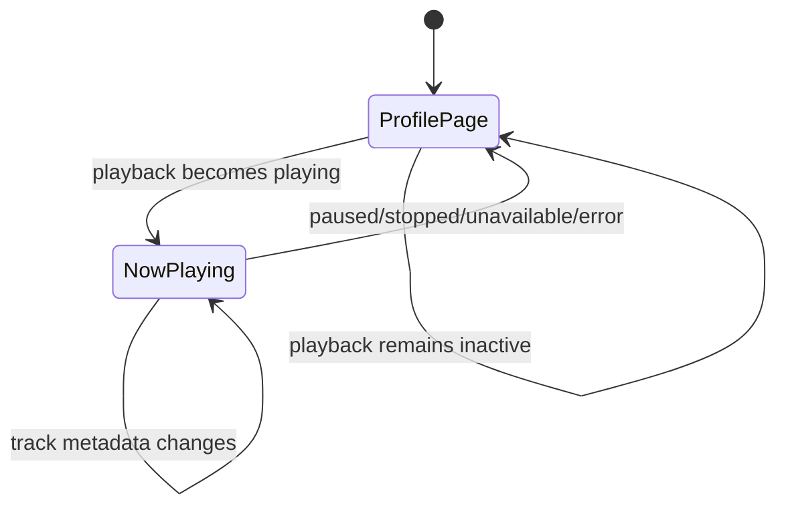

# DeckLink Feature Specification and Implementation Plan

## Scope and current baseline

This document specifies the requested UI/UX enhancements. It does not change application code.

The inspected baseline has a Python standard-library host, a plain JavaScript/HTML/CSS web client, a Tk desktop shortcut manager, a `config.json` containing named host settings and shortcut actions, a six-button swipable shortcut page, CPU/memory/disk/network cards, a selectable live graph, a connection indicator, pairing-token authentication, and toast feedback after button presses. The web client polls statistics every 2.5 seconds and host/action information every 10 seconds. No profiles, playback page, GPU temperature, PC discovery, import/export workflow, theme controls, or sign-in startup option were found in the inspected files.

### Decisions and placeholders

- Target host OS for the sign-in feature: **[FILL: Windows versions]**. Existing project scripts and manager target Windows, while the Python host contains Windows and Linux statistics paths.
- Supported DeckLink client/browser versions: **[FILL: supported Android versions and browser versions]**.
- Default theme: **[FILL: default theme]**. Current charcoal palette is the baseline until selected.
- Supported GPU vendors, APIs, and temperature sensors: **[FILL: telemetry sources]**.
- Playback providers and required controls: **[FILL: supported media players/services and controls]**.
- Playback absence definition: **[FILL: no active session vs paused session behavior]**. This specification treats active playback as a session reporting `playing`; paused/stopped/unavailable means the page is hidden unless product review chooses otherwise.
- Discovery transport and ports: **[FILL: discovery protocol, port, and firewall behavior]**.
- Layout schema version policy and migration support: **[FILL: compatibility policy]**.
- Startup behavior default: disabled until the user enables it.
- Network deployment remains local-network HTTP with the existing pairing token unless separately upgraded. Security improvements are low priority and are not prerequisites for this feature set.

## Feature specifications

### 1. Profiles

**Intent:** Let the user create and switch between named shortcut/layout sets, for example Gaming, Work, or Streaming, without removing existing shortcuts.

**User stories**

- As a user, I can create, rename, duplicate, reorder, and delete profiles.
- As a user, I can select the active profile on the client and in the desktop manager.
- As a user, I can keep the existing shortcuts in a default profile when upgrading.

**Behavior**

- A profile owns its display name, ordered pages, shortcuts, and optional profile-level UI preferences.
- Existing `actions` migrate into one profile named **[FILL: default profile name]** without changing action IDs, targets, arguments, or order.
- Switching profiles updates the visible shortcut pages and active-profile indicator. Do not execute an action as a side effect of switching.
- If profile data is missing or invalid, load the migrated/default profile and show a non-blocking status message.
- Now Playing is a system page, not an editable shortcut profile, and follows the availability behavior below.

### 2. Now Playing fullscreen page

**Intent:** Show a separate fullscreen page only while media is actively playing; otherwise, do not show the page or its navigation affordance.

**User stories**

- As a user, when playback starts, I can swipe or navigate to a dedicated Now Playing screen.
- As a user, when playback ends or is no longer active, the page disappears and I return to a valid profile page.

**Behavior and states**

- `unavailable`, `stopped`, `paused`, and `error`: page is absent from page count, dots, swipe navigation, and shortcuts. A visible player page is not rendered as a blank/empty placeholder.
- `playing`: insert one dedicated full-viewport page after the currently selected profile pages. It contains available title, artist, artwork, progress, and supported controls; omit each unavailable field/control rather than showing fabricated values.
- If active playback stops while Now Playing is open, return to the previously selected profile/page (or page zero if that location no longer exists) and announce that playback ended using a brief accessible status message.
- If playback changes track without stopping, refresh its metadata in place.
- Minimum controls: **[FILL: play/pause, previous, next, seek, volume requirements]**. Send control requests to the host; client does not control a player directly.
- Touch swipe, visible navigation controls, and keyboard navigation where available must follow the same page order and state transitions.

**State flow**



### 3. Additional statistics and temperature handling

**Intent:** Add useful PC stats while treating unsupported or unreliable iGPU temperature as not applicable, never as a real 0°C measurement.

**Potential metrics, subject to source support:** GPU load, GPU memory use, GPU temperature, battery state, free disk space, per-process resource use, and fan speed. Prioritize only metrics whose data source is supported and maintainable. **[FILL: approved metric list]**

**Temperature rules**

- Data is meaningful only when the provider explicitly reports a supported sensor value within its declared valid range. Provider absence, permission failure, parse failure, stale data, and a reported zero are represented as unavailable/not applicable unless the chosen provider proves zero is valid for that sensor.
- UI choice: either display `N/A`/`Not applicable` with no filled meter, or hide the temperature bar and retain a compact unavailable label. **[FILL: choose one; default recommendation: hide the bar and show “Not available”]**.
- Never draw a zero-height temperature meter as though the sensor were functioning. Do not include unavailable points in charts or summaries.
- Keep the card stable during transitions: stale values expire after **[FILL: staleness threshold]** and become unavailable.
- Include source and freshness metadata in host responses so clients can distinguish valid data, unsupported data, and errors.

**User stories**

- As a user, I can add supported system metrics and select any available metric for the live graph.
- As a user, I can tell whether a metric is unavailable instead of mistaking a missing reading for zero.

### 4. PC discovery and optional multiple PCs

**Intent:** Help the tablet find a DeckLink host on its local network. Connecting to multiple PCs is optional, not a launch requirement.

**Discovery flow**

1. Client shows a `Find a PC` action when no host is connected or when the user opens connection settings.
2. Discovery listens/queries only on the current local network using **[FILL: discovery protocol]**; do not assume Internet discovery.
3. Show candidates by friendly host name, local address, and a brief freshness/availability state. Do not show pairing tokens in the discovery list.
4. User selects a candidate and enters/pastes that host's pairing token if it is not already paired.
5. Verify the candidate with an authenticated info request before marking it connected.
6. If discovery is blocked, offer manual address entry and explain that device isolation/firewall settings may prevent detection.

**Optional multi-PC support**

- Store a named connection per PC with its base URL and locally held token; never export secrets with layouts.
- Show an explicit active-PC selector. Switching host changes stats and action pages to the chosen host and must not execute shortcuts.
- **[FILL: simultaneous monitoring vs one active host]**. Default recommendation: one active host at a time.
- If multi-PC support is deferred, still ship single-host discovery and manual connection entry.

### 5. Theme and sizing options

**Intent:** Let users adapt visual appearance and touch target size while preserving a clean, low-distraction interface.

**Options**

- Theme: `system`, `dark`, `light`, plus accent color **[FILL: allowed palette/custom color policy]**. The current dark charcoal design is the baseline.
- Shortcut density: `comfortable` and `compact`, controlling grid columns/gaps and button dimensions.
- Touch sizing: `standard` and `large`; large must increase hit area without clipping the six-button page or content on supported tablet sizes.
- Reduced motion: follow system preference where available and provide an explicit toggle if required **[FILL]**.
- Persist preferences per client/device in local storage; provide a reset-to-default action. Theme/sizing settings are client preferences unless a decision is made to sync them through profile export.
- Maintain readable contrast, visible focus/pressed states, and no reliance on color alone.

### 6. Layout JSON import/export

**Intent:** Back up and restore profiles and shortcuts using a portable JSON file.

**Workflow**

- Desktop manager provides `Export layout` and `Import layout` actions with file pickers, preview/validation, and a clear confirmation before replacing or merging data.
- Import options: **[FILL: replace all profiles, merge, or both]**. Default recommendation: preview then replace, with explicit confirmation; preserve current data until validation succeeds.
- Export includes profiles, pages, shortcut labels/icons/types/targets/arguments, and portable layout preferences. Export excludes pairing token, PC connection credentials, runtime state, playback state, and host secrets.
- Invalid files leave the current configuration unchanged and identify the failing field in plain language.
- Imported app actions remain subject to the existing host's configured-action model and are never arbitrary client commands. Show a warning/confirmation before importing app executable targets.
- Write to a temporary file, validate, then atomically replace the configuration to avoid partial saves.

**JSON shape**

```json
{
  "format": "decklink-layout",
  "schemaVersion": 1,
  "exportedAt": "[ISO-8601 timestamp]",
  "profiles": [
    {
      "id": "[stable profile id]",
      "name": "Work",
      "pages": [
        {
          "id": "[stable page id]",
          "name": "Page 1",
          "actions": [
            {
              "id": "[stable action id]",
              "label": "Open homepage",
              "icon": "⌂",
              "type": "url",
              "url": "https://example.com"
            }
          ]
        }
      ],
      "preferences": {
        "theme": "system",
        "density": "comfortable",
        "buttonSize": "standard"
      }
    }
  ],
  "activeProfileId": "[profile id]"
}
```

`schemaVersion` is required. Unknown future versions must be rejected with a useful message, not partially imported. Unknown optional fields in supported versions may be ignored. Exact maximum file size, action count, field limits, and migration policy: **[FILL]**.

### 7. Start DeckLink at Windows sign-in

**Intent:** Allow the user to have the DeckLink host ready after signing into Windows.

- Add an opt-in setting in the desktop manager: `Start host when I sign in`.
- Explain that this starts the local host in the background. Keep the setting off until explicitly enabled.
- Use the selected supported Windows startup integration: **[FILL: Startup folder, Task Scheduler, or other approved mechanism]**.
- Provide clear enable, disable, current status, and failure feedback. Disabling removes only DeckLink's own startup entry.
- Startup must not open a terminal or browser unless separately selected. The UI can be opened manually.
- Avoid duplicate host processes. If the host is already active, report that state rather than starting a second listener.
- Document required Python/runtime path and behavior when the installation folder moves.

### 8. Connection recovery

**Intent:** Recover from temporary Wi-Fi loss, tablet sleep, or host restart without losing the user's current context.

- Use a bounded retry schedule with backoff: **[FILL: intervals and maximum retry duration]**. Avoid a tight request loop.
- On a missed request, immediately show `Reconnecting…`; after **[FILL: offline threshold]**, show `Disconnected` and retain the current page/buttons in a disabled or clearly unavailable state.
- When the host responds again, verify the host identity/info and pairing token, refresh actions/stats/profile state, and restore the selected profile/page if it still exists.
- A 401 response prompts pairing again; network errors do not erase saved pairing data.
- Distinguish recoverable network failure, invalid token, unsupported API version, and host error with concise user-facing guidance.
- Add a manual `Reconnect` / `Find a PC` action. Avoid repeated toast popups; use a persistent, accessible connection status and one transition message.

### 9. Shortcut button feedback

**Baseline to preserve:** Existing buttons send a configured action ID and display a toast with success or an error message. A 401 reopens pairing; network failures update the connection indicator.

- Preserve this feedback and keep all existing shortcut execution behavior.
- On press, provide immediate pressed/working feedback and prevent accidental duplicate dispatch for the same button until the response or a timeout.
- On success, show the existing action label confirmation; on failure, show a concise message and keep the button available for retry.
- Do not claim an app has fully opened if the host only confirms that launch was requested. **[FILL: exact success wording]**.
- For offline states, do not silently queue launch actions. Show that the PC is disconnected.
- Accessibility: announce result through the existing live region and provide visible focus/pressed states.

### 10. Security considerations, low priority

- Continue sending only configured action IDs from the client; no arbitrary command execution.
- Keep host tokens out of layout exports, discovery advertisements, logs intended for sharing, and UI screenshots.
- Keep pairing, reset, and imported app action confirmation explicit.
- Discovery is local-network only unless a later requirement says otherwise. Do not expose the host publicly as part of these features.
- **[FILL: TLS/pairing renewal/security roadmap]**. Security work beyond preserving current safeguards is optional and low priority for this specification.

## Data and API/IPC contracts

### PC statistics model

```json
{
  "hostId": "[stable host id]",
  "capturedAt": "[ISO-8601 timestamp]",
  "cpu": { "value": 24, "unit": "%", "status": "available", "source": "[source]" },
  "memory": { "usedBytes": 4000000000, "totalBytes": 8000000000, "percent": 50, "status": "available" },
  "disk": { "usedBytes": 100000000000, "totalBytes": 250000000000, "percent": 40, "status": "available" },
  "network": { "downBytesPerSecond": 12500, "upBytesPerSecond": 2200, "status": "available" },
  "gpuTemperature": {
    "value": null,
    "unit": "°C",
    "status": "not_applicable",
    "source": "[provider or null]",
    "reason": "zero_or_unavailable",
    "updatedAt": null
  },
  "additional": {}
}
```

`status` is one of `available`, `not_applicable`, `unsupported`, `stale`, or `error`. `value` is numeric only when status is `available`; otherwise it is `null`. Do not infer unavailable values as zero. Exact field names are proposed and require compatibility review against the current `/api/stats` response.

### Playback model

```json
{
  "status": "playing",
  "title": "[track title or null]",
  "artist": "[artist or null]",
  "artworkUrl": "[URL or null]",
  "positionMs": 0,
  "durationMs": null,
  "canPlayPause": true,
  "canSkipNext": false,
  "canSkipPrevious": false,
  "updatedAt": "[ISO-8601 timestamp]"
}
```

Proposed API endpoints: `GET /api/playback` and `POST /api/playback/control` with an allowlisted control enum. **[FILL: final endpoint names, provider, polling/event strategy, and control schema]**. Playback metadata is unavailable until a provider integration is selected.

### Discovery and profile interfaces

- Proposed discovery endpoint/mechanism: **[FILL: protocol and message format]**. Discovery responses must not contain pairing tokens.
- Proposed profile configuration: `profiles[]`, `activeProfileId`; migration and config validation run on the host/manager before saving.
- Client-to-host commands should use allowlisted operations (`set_active_profile`, `play_pause`, `next`, `previous`) and stable IDs. Never accept arbitrary executable or command strings from the web client.
- Existing `/api/info`, `/api/stats`, and `/api/action` remain supported during migration. Exact version negotiation and backward-compatibility window: **[FILL]**.

## Implementation plan

1. **Decisions and compatibility:** Fill the open choices above, especially playback provider, Windows versions, temperature provider, current API compatibility policy, and layout replacement/merge behavior.
2. **Data/config foundation:** Define and validate versioned profiles/layout configuration; migrate current top-level `actions` into the default profile; add safe import/export and rollback behavior.
3. **Telemetry foundation:** Add capability-aware metric providers and normalized availability states. Test zero, absent, invalid, stale, permission-denied, and valid sensor results before exposing GPU temperature.
4. **Connection foundation:** Add local discovery plus manual address fallback; add bounded reconnect flow and host identity verification. Multi-PC saved connections can follow as an optional phase.
5. **Web client:** Build profile/page navigation, conditional Now Playing full-screen page, metric cards/graphs, missing-temperature state, themes/sizing, and accessible button states. Preserve swipe and old-browser compatibility requirements.
6. **Playback adapter:** Implement only after supported providers and controls are selected. Report playback as unavailable when no supported active provider exists.
7. **Desktop manager and Windows startup:** Add profile/layout management, import/export, theme defaults, and opt-in host-at-sign-in setting; make enable/disable idempotent.
8. **Regression and release:** Verify existing pairing, shortcut editing, six-button paging/swiping, graph selection, and toast feedback; validate import failure recovery, reconnect, and startup toggle behavior; update setup and migration documentation.

## Acceptance criteria and test cases

### Profiles and Now Playing

- With no playback, no Now Playing page, dot, page count, or swipe destination is present.
- When playback becomes active, exactly one fullscreen Now Playing page becomes reachable without reloading the client.
- Paused/stopped/unavailable/error playback removes the page; if it was open, the client returns to a valid previous profile page.
- Metadata updates in place on track change. Missing art/title/artist do not break layout.
- Profile create/rename/duplicate/delete/switch persist correctly. Existing shortcuts migrate without changing their targets or IDs.

### Stats and temperature

- Valid supported metric values render with correct units and graph samples.
- Temperature `0`, null, unsupported source, malformed result, permission error, and stale result never appear as a valid zero reading.
- The chosen not-applicable/hide-bar behavior is consistent in cards and graphs; unavailable values produce no chart point.
- Failure of one metric does not prevent other cards or graphs from updating.

### Discovery and recovery

- A host on the same reachable network appears without displaying its token; user must pair/authenticate before use.
- Discovery failure leaves a clear manual connection path.
- Temporary disconnect displays recovery state, uses bounded retries, preserves layout/page, and resumes after host return.
- Invalid token asks for pairing; transient failure does not erase the token.
- Optional multi-PC tests verify switching hosts cannot dispatch actions to the previously selected host.

### Theme, sizing, layouts, and startup

- Theme, density, and button size persist across refresh and fit supported viewport sizes without hiding navigation.
- Reset restores the configured default theme and sizing.
- Exported JSON validates against the selected schema and contains no pairing token or saved connection secret.
- Valid import preview/confirmation updates configuration atomically; invalid or unsupported-version import leaves existing configuration untouched.
- Imported app targets receive the selected confirmation and remain server-configured actions.
- Windows startup option is off by default, enable/disable is repeatable, disabling does not remove unrelated startup items, and sign-in starts at most one host without a terminal/browser.
- Missing Python path, moved installation, and host port conflict produce actionable status.

### Button feedback and regression

- Existing configured shortcut action IDs continue to work; invalid IDs and host errors show useful feedback.
- A successful press receives immediate press feedback and one success result; repeated taps do not create unintended duplicate dispatches.
- Disconnected actions are not queued or silently dropped; the user is told to reconnect.
- Existing pairing, six-button pages, swipe navigation, stat graph selection, and connection indicator continue to work on the supported older Android browser matrix **[FILL]**.

## Clarifying rule

If a UI choice, provider behavior, or compatibility detail is unspecified, preserve existing DeckLink behavior, show an explicit unavailable state rather than inventing a value, and keep the related capability optional until the placeholder is resolved. Do not treat a paused session as active playback unless the playback requirement is explicitly changed.
